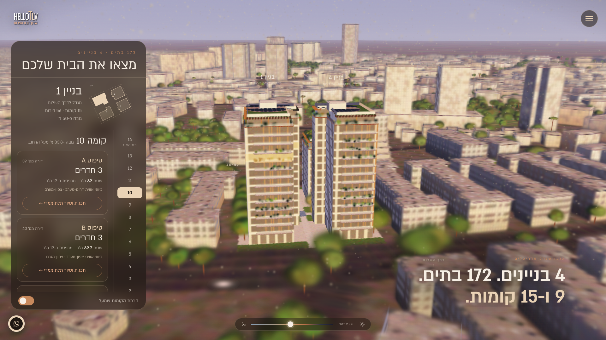
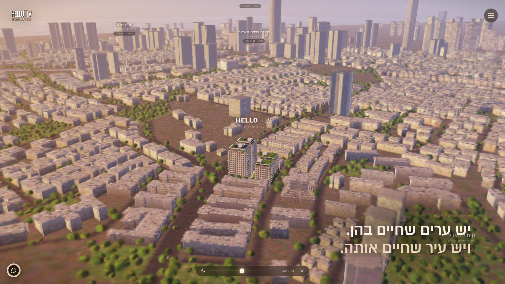
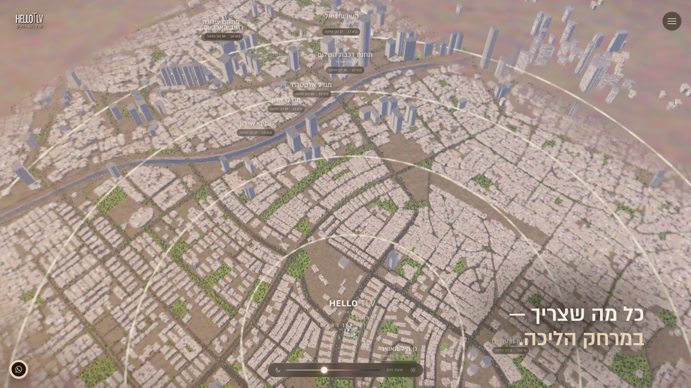
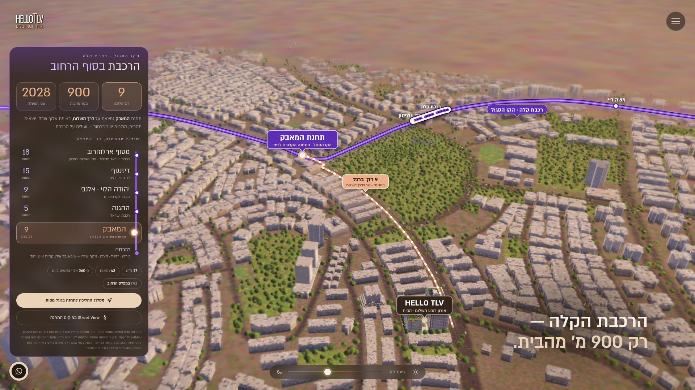
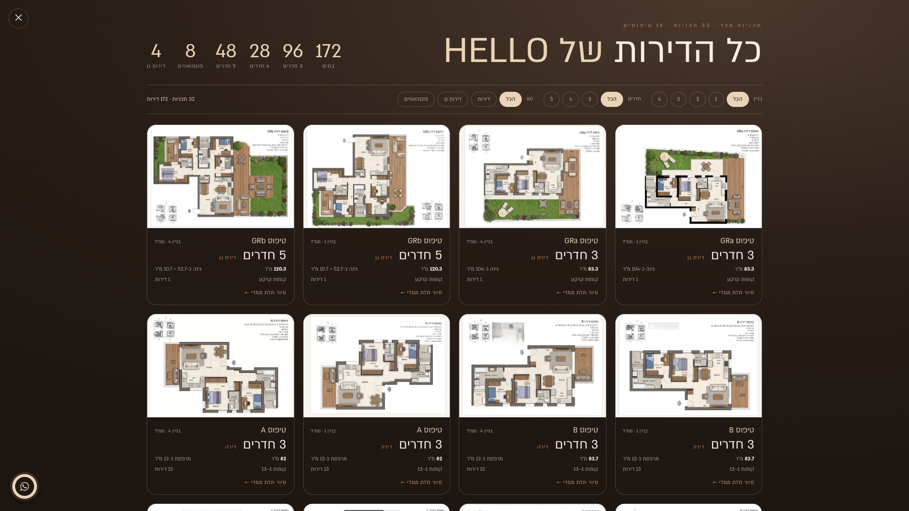
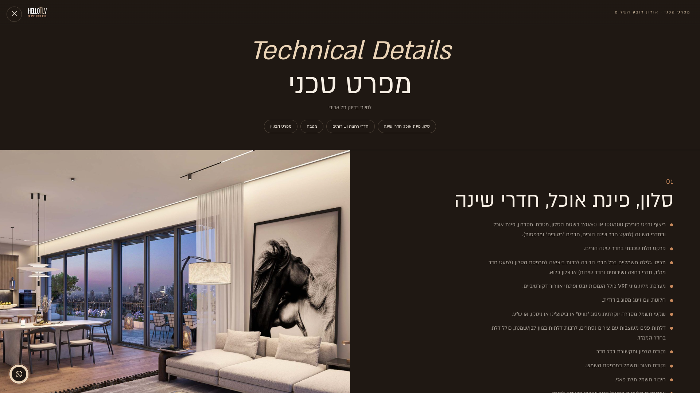
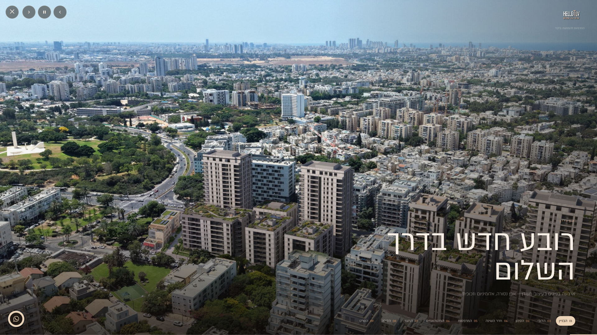

<div dir="rtl">

# HELLO TLV · אורון רובע השלום

הדמיה תלת ממדית אינטראקטיבית של פרויקט **HELLO TLV** — דרך השלום 87, תל אביב.
החוויה רצה בדפדפן, בזמן אמת, ומציגה את הפרויקט בתוך העיר: המיקום, הרכבת הקלה, הבניינים, הדירות, המפרט וההדמיות.



## פרקי החוויה

| | |
|---|---|
| **העיר** — מבט על תל אביב סביב הפרויקט | **המיקום** — מסלולי הליכה לפארק וולפסון, עזריאלי, שרונה, רכבת השלום והים |
|  |  |
| **הרכבת הקלה** — הקו הסגול ותחנת המאבק | **הפרויקט** — המגדלים והבניינים במגרש |
|  |  |
| **הדירות** — תוכניות מכר ובית בובות תלת ממדי לכל דירה | **מפרט טכני** |
|  |  |
| **הדמיות** — גלריית הדמיות חוץ ופנים | |
|  | |

## הפעלה מקומית

הפרויקט הוא אתר סטטי ללא תלויות — צריך רק שרת קבצים מקומי (פתיחה ישירה של `index.html` לא תעבוד, כי הסצנה נטענת ב-`fetch`).

**ב-Mac:** לחיצה כפולה על `פתיחת ההדמיה.command` — השרת יעלה והדפדפן ייפתח אוטומטית.

**ידנית:**

```bash
python3 -m http.server 8765
# ואז לפתוח http://127.0.0.1:8765
```

נדרש דפדפן עם תמיכה ב-**WebGL2** (Chrome, Edge, Safari או Firefox עדכניים).

## טכנולוגיה

- **מנוע רינדור Gaussian Splats עצמאי** ב-WebGL2 (`app.js`) — ללא ספריות חיצוניות.
- הסצנה כוללת כ-1.27 מיליון splats, מחולקים לשכבות (קרקע, כבישים, עצים, העיר, הפרויקט, רכבת, תוכניות ועוד).
- הסצנה נבנית באופן פרוצדורלי מנתוני OpenStreetMap באמצעות סקריפטי Python.

## מבנה התיקייה

| קובץ / תיקייה | תיאור |
|---|---|
| `index.html` | דף הכניסה, ממשק וסגנון |
| `app.js` | מנוע הרינדור והסיפור (מצלמה, פרקים, אינטראקציה) |
| `apartments.js` | פרק הדירות ותוכניות המכר |
| `about.js`, `pages.js` | עמודי תוכן (אודות, מפרט ועוד) |
| `scene.bin`, `scene.json` | נתוני הסצנה הבינאריים והמטא-דאטה שלהם |
| `assets/` | פונטים, לוגו, תוכניות, הדמיות, וידאו ונתוני מסלולים / רכבת |
| `src/` | סקריפטי הבנייה ונתוני המקור (OSM, תוכניות, רכבת) |
| `screenshots/` | צילומי מסך של המערכת |
| `HELLO-TLV_gaussian-splats.ply` | ייצוא הסצנה בפורמט PLY סטנדרטי |
| `HELLO-TLV_סרטון-מערכת-30s.mp4` | סרטון הדגמה של 30 שניות |

## בניית הנתונים מחדש

הסקריפטים ב-`src/` דורשים Python 3 עם `numpy`, `opencv-python` ו-`PyMuPDF`:

```bash
python3 src/build_scene.py <osm_dir> <out_dir> <logo_png>   # scene.bin + scene.json
python3 src/build_walks.py                                  # assets/walks.json
python3 src/build_rail.py                                   # assets/rail.json
python3 src/build_plans.py <plans.pdf> <jpg_dir> <ocr.jsonl> <labels.json> <out_dir>
```

> מיקומי תחנות הרכבת הקלה מקורבים, על בסיס מפות נת״ע ונתוני OSM.

---

© אורון נדל״ן · HELLO TLV. כל הזכויות שמורות.

</div>
